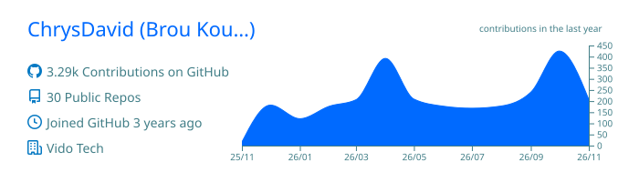
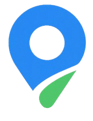
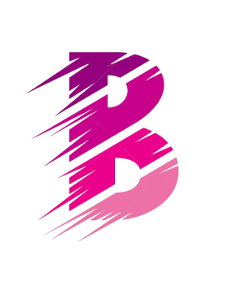

<div align="center">


<a href="https://github.com/ChrysDavid">
  
</a>

<p>
  
  <a href="https://github.com/ChrysDavid?tab=followers">
    
  </a>
  
</p>

</div>

<h3 align="center">Je transforme des idées en applications web, mobiles et intelligentes.</h3>

<table align="center">
  <tr>
    <td align="center" width="33%">
      <h3>🌐</h3>
      <strong>Web Full Stack</strong><br/>
      <sub>Django · Vue.js · API REST · temps réel</sub>
    </td>
    <td align="center" width="33%">
      <h3>📱</h3>
      <strong>Apps mobiles</strong><br/>
      <sub>Flutter · iOS &amp; Android · Clean Architecture</sub>
    </td>
    <td align="center" width="33%">
      <h3>🤖</h3>
      <strong>Automatisation IA</strong><br/>
      <sub>Agents IA · workflows · intégration d'API IA</sub>
    </td>
  </tr>
</table>

<p align="center">
  
  
  
  
  
</p>

<p align="center"><em>Full Stack, Mobile & AI Automation Developer · open to freelance and remote work</em></p>

---

## 👨‍💻 À propos de moi

```python
class ChrysDavid:
    def __init__(self):
        self.name      = "Kouamé Chrys David Brou"
        self.role      = "Full Stack, Mobile & AI Automation Developer (Freelance)"
        self.education = "Licence en Génie Logiciel — Institut Ivoirien de Technologie (IIT)"
        self.languages = ["Français", "English"]
        self.stack     = ["Django", "Flutter", "Vue.js", "Node.js", "Firebase", "MySQL"]
        self.ai_tools  = ["Claude", "GitHub Copilot", "ChatGPT"]
        self.automation = ["Agents IA", "Workflows automatisés", "Intégration API IA"]
        self.portfolio = "https://brou-kouame-chrys-david.onrender.com/"

    def current_focus(self):
        return "Plusieurs projets en parallèle, chacun sur un stack différent, accélérés par l'IA."

print(ChrysDavid().current_focus())
```

---

## 🚀 Stack Technique

**Langages**


**Mobile**


**Web**


**Bases de données**


**IA & Automatisation**


- 🧠 Génération et revue de code assistée
- 💬 Intégration de chatbots dans des apps web/mobile
- 📊 Analyse de données et automatisation Python + IA
- 🔍 Prompt engineering pour des workflows sur mesure

**Design & CMS**


**Outils**


---

## 📊 GitHub Stats

<div align="center">
  
  
</div>

<div align="center">
  
</div>

<div align="center">
  
</div>

---

## 🧩 Projets en vedette

> 🔗 Démos, captures et détails de chaque projet sur **[mon portfolio](https://brou-kouame-chrys-david.onrender.com/)**

### 🧠 [Djo 1](https://huggingface.co/ChrysDavid/djo-1-gguf) : le modèle d'IA ivoirien

<table>
  <tr>
    <td valign="top">
      <p><strong>Djo 1</strong> est un modèle de langage (LLM) <strong>100 % ivoirien</strong> que je développe pour la <strong>Côte d'Ivoire</strong> : une IA qui comprend le contexte ivoirien et tourne en local, même sur un ordinateur modeste.</p>
      <p>
        
        
        
        
      </p>
      <p>
        <a href="https://huggingface.co/ChrysDavid/djo-1-gguf"></a>
      </p>
      <p><strong>🚧 En développement · IA locale · Côte d'Ivoire</strong></p>
    </td>
  </tr>
</table>

<table>
  <tr>
    <td width="33%" valign="top">
      <h3> <a href="https://vidotrack.com/">VidoTrack</a></h3>
      <p><strong>Suivi GPS en temps réel des flottes</strong> pour écoles, universités, entreprises et transporteurs : localisation des véhicules en direct, optimisation des trajets, sécurité des passagers et tableaux de bord.</p>
      <p>
        
        
        
        
        
      </p>
      <p><strong>📍 GPS · Temps réel · Web & mobile</strong></p>
    </td>
    <td width="33%" valign="top">
      <h3> <a href="https://babikiss.app/">BabiKiss</a></h3>
      <p><strong>App de rencontre pensée pour Abidjan</strong> : Cupidon, un assistant IA, remplit le profil en discutant, compare les réponses à des mini-jeux quotidiens et présente une seule personne vraiment compatible.</p>
      <p>
        
        
        
        
        
      </p>
      <p><strong>🤖 Assistant IA · Mobile · Jeux web</strong></p>
    </td>
    <td width="33%" valign="top">
      <h3> <a href="https://vido-school-front-web.onrender.com">Vido School</a></h3>
      <p><strong>App EdTech pour les lycéens africains</strong> : tests d'orientation, bulletin numérique avec calcul des moyennes, assistant IA VidoBot, jeux éducatifs, agenda et apprentissage des langues.</p>
      <p>
        
        
        
        
        
      </p>
      <p><strong>📱 iOS & Android · Éducation · Afrique</strong></p>
    </td>
  </tr>
</table>

---

## 🤖 Automatisation intelligente avec l'IA

En plus du développement web et mobile, je conçois des **agents IA** et des **workflows automatisés** qui font gagner du temps aux équipes :

- 🧠 **Agents IA** branchés sur vos données et vos outils (support client, qualification de prospects, assistants internes)
- ⚙️ **Workflows automatisés** entre applications, API et bases de données (tâches répétitives, rapports, notifications)
- 🔌 **Intégration d'API IA** (Claude, OpenAI, Gemini, Groq) dans des apps Django, Flutter et Vue.js
- ✍️ **Prompt engineering** pour des réponses fiables et adaptées à votre métier

---

## 🌍 Me contacter

<div align="center">

[](https://brou-kouame-chrys-david.onrender.com/)
[](https://www.linkedin.com/in/kouam%C3%A9-chrys-david-brou-45b8582a1/)
[](https://huggingface.co/ChrysDavid)
[](https://github.com/ChrysDavid)
[](https://www.facebook.com/share/XK7gyN6QzyoZgdMP/)
[](https://www.instagram.com/vido_84/)
[](https://www.tiktok.com/@chrysdavid)

**💼 Disponible pour des projets freelance & collaborations**


</div>
